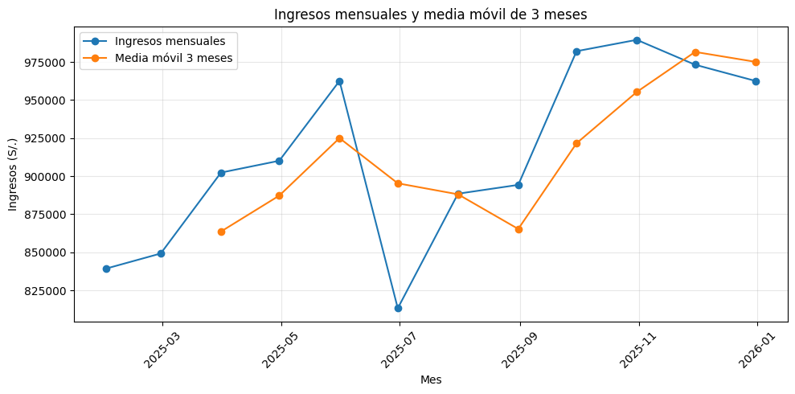
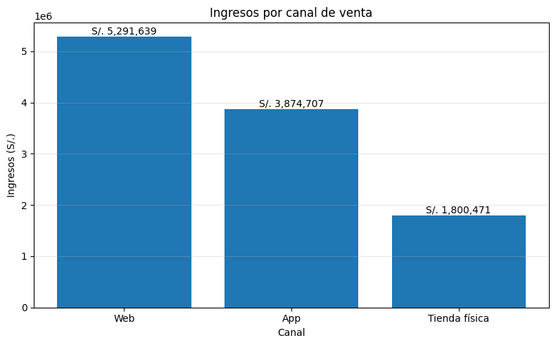

# Análisis de ventas end-to-end · MySQL → Python → Power BI

Pipeline completo de análisis de datos sobre un negocio de ventas multicanal: modelado relacional en **MySQL**, carga y validación con **Python (Pandas + SQLAlchemy)**, cálculo de KPIs y tendencias, y un **dashboard interactivo en Power BI** con medidas DAX.

> Proyecto final de la especialización *Automatización y Análisis de Datos* (150 h, 2026).

---

## Resultados clave

| KPI | Valor |
|---|---|
| Ingresos totales | **S/. 10,966,816.60** |
| Ticket promedio (AOV) | **S/. 3,655.61** |
| Tasa de cancelación | **17.1 %** |
| Mes pico | **Octubre 2025** · S/. 989,543.79 |
| Registros procesados | **10,953** (300 clientes · 150 productos · 3,000 pedidos · 7,503 líneas de detalle) |

### Hallazgos de negocio

1. **El canal Web lidera:** concentra el **48.25 %** de los ingresos (S/. 5.29 M) y tiene el AOV más alto (S/. 3,690).
2. **Caída puntual en junio (−15.5 %)** seguida de una recuperación sostenida hasta el pico de octubre.
3. **Riesgo de quiebre de stock:** se detectaron **6 productos con menos de 10 unidades** que siguen vendiéndose → prioridad de reposición.
4. **Hogar** es la categoría con mayores ingresos (S/. 2.02 M); el segmento **VIP** tiene el ticket promedio más alto (S/. 3,826).

<p align="center">
  
  
</p>

---

## Arquitectura

```
CSV ──► Pandas (limpieza, tipos de fecha) ──► MySQL (modelo relacional, PK/FK)
                                                   │
                     ┌─────────────────────────────┴───────────────┐
                     ▼                                             ▼
        Python: KPIs, resample, rolling,               Power BI: conexión directa,
        pct_change, análisis por canal/segmento        medidas DAX, dashboard
```

## Fases

| Fase | Qué se hizo | Archivo |
|---|---|---|
| 1. Modelado | Base `proyecto_final` con 4 tablas, claves primarias/foráneas y relaciones 1:N | [`sql/proyecto_final.sql`](sql/proyecto_final.sql) |
| 2. Carga y validación | Carga con `to_sql()` en orden de dependencias y conciliación CSV vs MySQL fila por fila (4/4 tablas OK) | [`notebooks/analisis_ventas.ipynb`](notebooks/analisis_ventas.ipynb) |
| 3. Consultas de negocio | 5 consultas SQL: ingresos por categoría, top 10 clientes, % por canal, VIP inactivos >60 días, stock crítico | [`sql/proyecto_final.sql`](sql/proyecto_final.sql) |
| 4. KPIs y tendencias | Función `calcular_kpis()`, series mensuales (`resample`), media móvil 3M (`rolling`), variación mensual (`pct_change`), comparativas por canal y segmento | [`notebooks/analisis_ventas.ipynb`](notebooks/analisis_ventas.ipynb) |
| 5. Dashboard | Power BI conectado a MySQL; medidas DAX *Ingresos Totales*, *N° de Pedidos* y *Ticket Promedio*; tarjetas, tendencia, categorías, canales y segmentador | [`dashboard/dashboard_ventas.pbix`](dashboard/dashboard_ventas.pbix) |

El informe completo está en [`docs/informe_final.docx`](docs/informe_final.docx).

## Stack

`MySQL 8` · `Python 3.13` · `Pandas` · `SQLAlchemy` · `PyMySQL` · `Matplotlib` · `Jupyter` · `Power BI` · `DAX`

## Cómo reproducirlo

```bash
# 1. Crear el esquema
mysql -u root -p < sql/proyecto_final.sql

# 2. Instalar dependencias
pip install -r requirements.txt

# 3. Configurar credenciales (no se versionan)
cp .env.example .env    # y edita los valores
```

4. Coloca los CSV en `data/` (ver [`data/README.md`](data/README.md)).
5. Exporta las variables de `.env` y ejecuta `notebooks/analisis_ventas.ipynb`.
6. Abre `dashboard/dashboard_ventas.pbix` en Power BI Desktop y actualiza la conexión a tu MySQL local.

---

**Jordan Smith Gallardo Palomino** · Ingeniería Informática, Universidad Nacional de Trujillo
